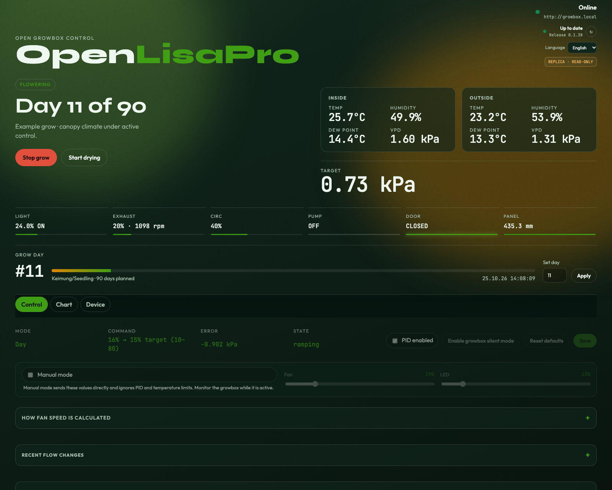
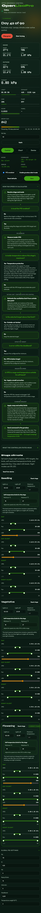
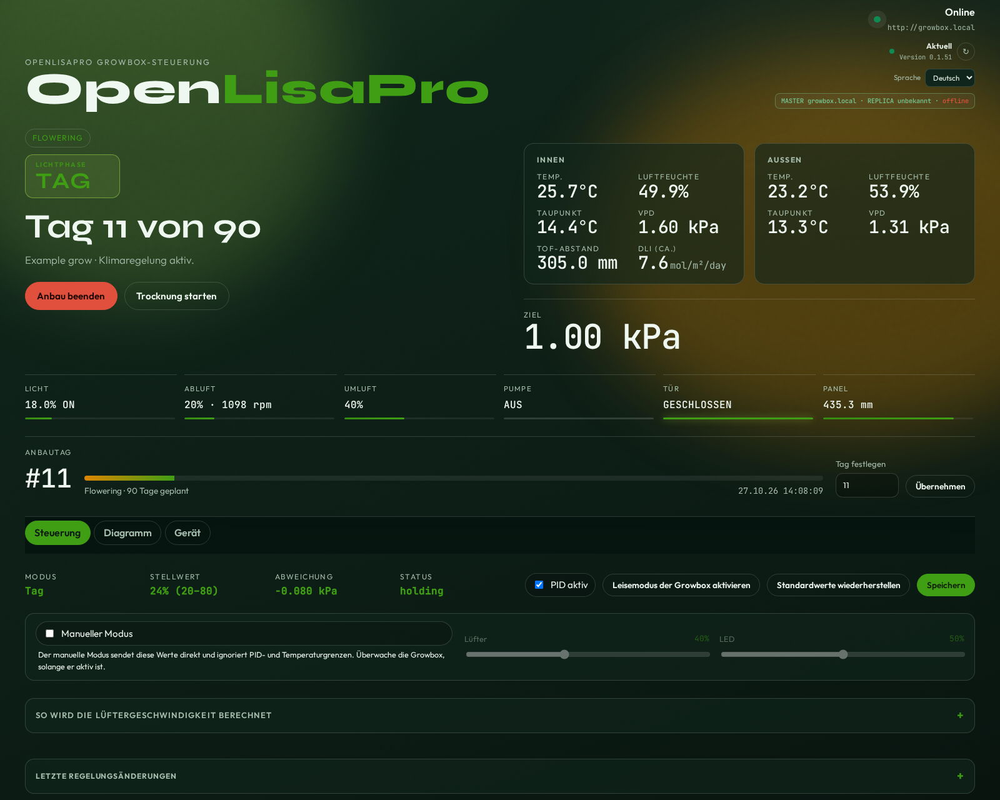
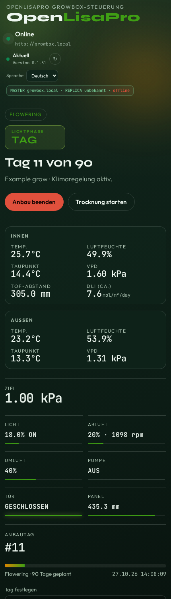

# OpenLisaPro

English | [Deutsch](README.de.md)

<p align="center"></p>

OpenLisaPro is a self-hosted Flask dashboard and Python client for Lisa Pro / LuminaGrowX growboxes. It displays live climate and device status, manages local control settings, and can run a VPD-based fan controller.

The browser communicates with the local Flask app, which proxies requests to the growbox. Current local control settings remain in `control.json`. Sensor measurements, controller state, settings snapshots, and controller flow events are stored indefinitely in `openlisapro.sqlite3`. The chart continues to show the latest 48 hours; the full dataset is available from `/api/data/export?format=jsonl` or `/api/data/export?format=csv`.

## Features

- Monitor inside and outside temperature, humidity, dew point, VPD, grow stage, and device status.
- Estimate daily light integral (DLI) from ToF distance, LED output, the active phase's light schedule, and FluxShield Habibi 150 Enhanced PPFD data.
- Configure per-stage fan limits, VPD targets, temperature limits, LED levels, and light schedules.
- Optionally control exhaust fan speed with a local PID loop and temperature protection.
- Use complete manual mode to set fan and LED percentages directly, bypassing PID and temperature overrides.
- Show sensor temperature and humidity to one decimal place when device readings include fractions.
- Gradually boost fan speed above a stage's soft temperature limit until temperature starts falling, with a per-stage boost cap.
- Review a two-day fan and VPD chart, or page through the full controller flow history.
- Keep a permanent SQLite telemetry dataset with raw device readings, controller state, and the settings active for each sample; export it as JSON Lines or CSV for analysis.
- Switch the dashboard between English and German.
- Use `LisaProClient` to access the device API from Python.

## Quick start

Requires Python 3.9+, [`uv`](https://docs.astral.sh/uv/), and a reachable growbox for live device features.

```bash
uv sync
LISA_PRO_URL=http://192.168.1.50 uv run lisa-pro-ui
```

## High availability

Run one OpenLisaPro primary and one replica, both connected to the same growbox. Every five seconds, the replica syncs the primary's configuration, SQLite measurements, flow events, and their settings snapshots. It keeps controls read-only while the primary is healthy. If the primary becomes unreachable, the replica takes over the control loop; when the primary returns, the replica resumes read-only mode. The primary uses the default `LISA_PRO_HA_ROLE=primary`. Both instances need network access to the growbox, and the replica must be able to reach the primary. See [Installation and configuration](docs/installation.md) for all HA variables and deployment details.

Configure the replica with the same `LISA_PRO_URL`, a separate data directory, its replica role, and the primary's URL:

```bash
LISA_PRO_URL=http://192.168.1.50 \
LISA_PRO_DATA=./replica-data \
LISA_PRO_HA_ROLE=replica \
LISA_PRO_HA_MASTER_URL=http://192.168.1.51:5050 \
uv run lisa-pro-ui
```

## Documentation

- [Installation and configuration](docs/installation.md)
- [Using local fan control](docs/control.md)
- [Specifications](docs/specifications.md)
- [Python client](docs/python-client.md)
- [Development, tests, and release builds](docs/development.md)
- [Changelog](CHANGELOG.md)
- [Growbox HTTP API reference](openapi.yaml)

## Screenshots

### English





### Deutsch




